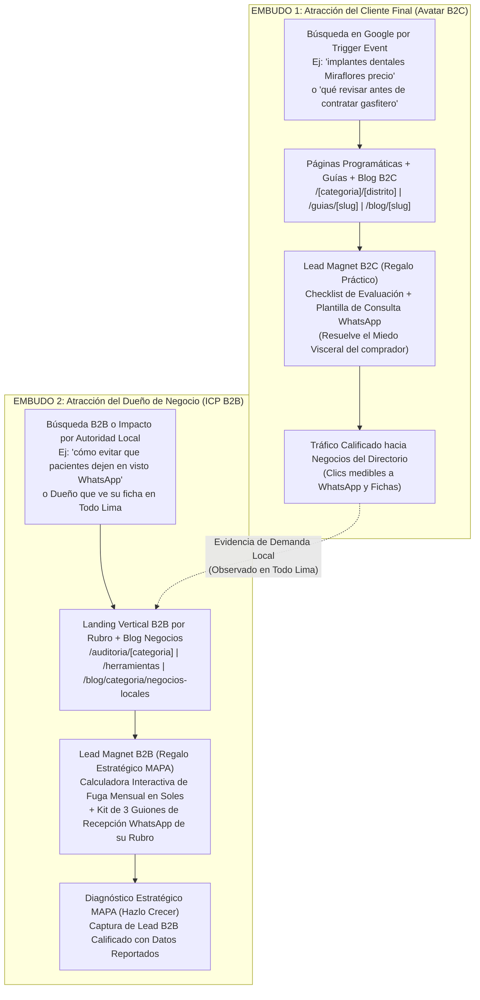

# ESTRATEGIA MAESTRA DE SEO ORGÁNICO, INTENCIONES DE BÚSQUEDA Y LEAD MAGNETS (DOBLE AVATAR) — TODO LIMA & HAZLO CRECER

> **Arquitectura de Atracción Orgánica Basada en [`auditor/config/buyerPersonas.js`](../auditor/config/buyerPersonas.js)**  
> **Frameworks Integrados:** Russell Brunson (*Traffic Secrets*, *DotCom Secrets* Value Ladder, *Expert Secrets* Big Domino) + Jim Edwards (*Hook, Story, Offer*) + Metodología **MAPA** (*Mapear, Aislar, Poner Precio, Atacar*).

---

## 1. Diagnóstico de la Arquitectura Actual de Todo Lima (`todolima.com`)

Al auditar el código actual de **Todo Lima**, identificamos **4 brechas de alto impacto SEO y de conversión** que hoy podemos capitalizar de inmediato porque ya contamos con la matriz completa de las **56 categorías** en [`auditor/config/buyerPersonas.js`](../auditor/config/buyerPersonas.js):

1. **Páginas Hiperlocales por Distrito (`/[subdomain]/[district]`) limitadas al 14% del catálogo:**
   * En [`lib/directory.js`](../lib/directory.js), la constante `PILOT_CATEGORIES` restringe la generación de páginas `/{categoria}/{distrito}` a solo **8 categorías piloto** (`gasfiteros`, `cerrajeros`, `mudanzas`, `reparacion-lavadoras`, `reparacion-refrigeradoras`, `reparacion-laptops`, `camaras-de-seguridad`, `veterinarias`).
   * **Oportunidad perdida:** Las 48 categorías restantes —incluyendo todo el **Tier 1 Élite** (`dentistas`, `abogados`, `agentes-inmobiliarios`, `arquitectura`, `dermatologos`, `psicologos`, `contadores`, `notarias`, `talleres-mecanicos`, `locales-de-eventos`)— no tienen páginas indexables por distrito (ej. `/dentistas/miraflores`, `/abogados/san-isidro`, `/talleres-mecanicos/surquillo`).
2. **Guías Editoriales de Decisión (`/guias/[slug]`) solo en 8 de las 56 categorías:**
   * En [`lib/guides.js`](../lib/guides.js) solo existen 8 guías. En [`app/[subdomain]/page.js`](../app/%5Bsubdomain%5D/page.js), el bloque `<section>Guías para decidir</section>` queda vacío en 48 categorías.
3. **Páginas B2B genéricas (`/para-negocios` y `/auditoria`):**
   * Hoy [`app/para-negocios/page.js`](../app/para-negocios/page.js) y [`app/auditoria/page.js`](../app/auditoria/page.js) hablan a "cualquier negocio en Lima" de forma genérica. Un Director Médico Odontológico no busca en Google *"auditoría digital para negocios"*; busca *"cómo captar pacientes de ortodoncia e implantes en Lima"* o *"sistema de citas por WhatsApp para clínica dental"*.
4. **Ausencia de Lead Magnets interactivos conectados a los datos de cada categoría:**
   * Contamos con los parámetros exactos de cada rubro (`visceralFear`, `triggerEvent`, `primaryBottleneck`, `hookStoryOffer`, y la ecuación económica MAPA $L \times (c_1 - c_0) \times T$), pero aún no están expuestos en el frontend público como imanes de captura (Lead Magnets) para el consumidor (B2C) ni para el dueño del negocio (B2B).

---

## 2. El Motor de Doble Embudo Orgánico (B2C + B2B)

En un directorio transaccional conectado a una consultora de conversión y automatización (**Todo Lima $\rightarrow$ Hazlo Crecer**), el SEO orgánico debe operar en **dos niveles simultáneos y simbióticos**:

---

## 3. Mapa de Intenciones de Búsqueda (Search Intent Matrix) Basado en nuestros Buyer Personas

Cada campo que ya programamos en [`auditor/config/buyerPersonas.js`](../auditor/config/buyerPersonas.js) se traduce directamente en una **familia de palabras clave (keywords)** con intención de búsqueda específica:

| Campo en `buyerPersonas.js` | Tipo de Intención SEO | Fórmula de Búsqueda en Google (Lima) | Tipo de Página Destino en Todo Lima |
| :--- | :--- | :--- | :--- |
| **`endCustomerAvatar.triggerEvent`** *(Evento Disparador)* | **Transaccional / Urgencia Local (BOFU B2C)** | `[categoría] en [distrito]` / `[servicio de urgencia] cerca de mí [distrito]` *(ej. "cerrajero 24 horas Lince", "clínica dental urgencia Jesús María")* | **Páginas Hiperlocales:** `/[subdomain]/[district]` y `/[subdomain]` |
| **`endCustomerAvatar.visceralFear`** *(Miedo Visceral)* | **Investigación Comercial / Comparativa (MOFU B2C)** | `qué revisar antes de contratar [categoría] en Lima` / `cómo saber si un [profesional] es confiable` *(ej. "qué preguntar antes de ponerse implantes dentales", "cómo revisar contrato de remodelación")* | **Guías de Decisión (`/guias/[slug]`)** + **Artículos de Blog (`/blog/[slug]`)** |
| **`endCustomerAvatar.burningDesire`** *(Deseo Ardiente)* | **Informacional / Planificación (TOFU-MOFU B2C)** | `mejores zonas / opciones para [objetivo] en Lima` / `cómo preparar [proyecto/evento] en Lima` | **Clústeres Temáticos en `/blog`** enlazados a `/[subdomain]` |
| **`icpB2B.primaryBottleneck`** *(Cuello de Botella del Dueño)* | **Dolor Operativo B2B (MOFU B2B)** | `por qué mis clientes piden precio por WhatsApp y no compran` / `cómo organizar citas de [categoría] por WhatsApp` | **Blog B2B (`/blog/categoria/negocios-locales`)** + **Herramientas (`/herramientas`)** |
| **`brunsonFramework.opportunitySwitch`** *(Nueva Oportunidad)* | **Transaccional B2B (BOFU B2B)** | `automatizar recepción WhatsApp para [categoría]` / `auditoría comercial para [categoría] en Lima` | **Nuevas Landings B2B por Rubro:** `/auditoria/[categoria]` |

---

## 4. Estrategia de Nuevas Páginas a Crear en Todo Lima (SEO Programático & Vertical)

### 4.1. Expansión de Páginas Hiperlocales `/[subdomain]/[district]` a las 56 Categorías
* **Estado actual:** Solo 8 categorías generan rutas por distrito en [`lib/directory.js`](../lib/directory.js) (`PILOT_CATEGORIES`).
* **Implementación:** Ampliar la generación estática (`getLocalPages()`) a las **56 categorías verificadas** siempre que un distrito tenga $\ge 3$ o $\ge 5$ negocios verificados con teléfono.
* **Enriquecimiento Semántico con `buyerPersonas.js`:**
  * En [`app/[subdomain]/[district]/page.js`](../app/%5Bsubdomain%5D/%5Bdistrict%5D/page.js), inyectar dinámicamente un bloque de **"Criterios de Evaluación Rápida en [Distrito]"** basado en el `endCustomerAvatar` de la categoría (qué preguntar por WhatsApp antes de agendar o transferir un adelanto).
* **Impacto SEO:** Más de **450 nuevas landing pages hiperlocales** (ej. `/dentistas/miraflores`, `/abogados/san-isidro`, `/psicologos/surco`, `/talleres-mecanicos/la-victoria`, `/notarias/san-borja`) atacando búsquedas de cola larga (*long-tail*) con altísima intención de compra y baja competencia orgánica.

### 4.2. Expansión de `/guias/[slug]` de 8 a 56 Guías Maestras de Contratación
* **Estado actual:** Solo 8 guías en [`lib/guides.js`](../lib/guides.js).
* **Implementación:** Generar las **48 guías restantes** (1 por cada una de las 56 categorías activas) conectadas directamente al `visceralFear` (miedo visceral del cliente) y `burningDesire` de cada categoría.
* **Ejemplos de alto impacto (Tier 1 y Tier 2):**
  * `dentistas`: *"Qué confirmar antes de iniciar un tratamiento de ortodoncia o implantes dentales en Lima"*
  * `abogados`: *"Checklist antes de contratar un estudio de abogados en Lima: honorarios, etapas y alcance"*
  * `agentes-inmobiliarios`: *"Qué revisar antes de firmar un contrato de corretaje o arras inmobiliarias en Lima"*
  * `albanileria-y-remodelaciones`: *"Cómo comparar presupuestos de remodelación en Lima sin sobrecostos ni abandonos de obra"*
  * `talleres-mecanicos`: *"Qué exigir en la orden de recepción antes de dejar tu auto en un taller mecánico en Lima"*

### 4.3. Nuevas Páginas Verticales B2B por Rubro: `/auditoria/[categoria]` (56 Landings de Conversión B2B)
* **Por qué es clave:** Cuando un dueño de negocio (o nuestro equipo comercial desde WhatsApp) visita una página de auditoría, una página genérica convierte entre 1% y 2%, mientras que una página verticalizada para su rubro convierte entre 8% y 15%.
* **Arquitectura de `/auditoria/[categoria]` (alimentada 100% desde `auditor/config/buyerPersonas.js`):**
  1. **Headline (Hook de Jim Edwards):** `brunsonFramework.hookStoryOffer.hook` *(ej. "¿Sabías que hasta el 40% de las consultas de ortodoncia e implantes en Lima se van a otra clínica por responder el WhatsApp más de 30 minutos tarde?")*.
  2. **Espejo de Realidad Operativa (`icpB2B`):** Describe exactamente la rutina de `icpB2B.decisionMaker` (`dailyReality`) y su fuga principal (`primaryBottleneck`).
  3. **Radiografía de su Cliente Ideal en Lima (`endCustomerAvatar`):** Muestra al dueño del negocio cómo compra hoy su cliente (`mobileBehavior`, `triggerEvent`, `visceralFear`) cuando busca en Todo Lima y Google Maps.
  4. **Simulador Interactivo MAPA (Lead Magnet en vivo):** Permite al dueño mover 3 controles deslizantes (*Consultas al mes $L$*, *Ticket promedio $T$*, *Tasa de cierre actual $c_0$*) pre-cargados con los valores reales de su rubro en Lima (`mapaEconomics`) para ver exactamente cuántos miles de soles pierde al mes.
  5. **Destrucción de las 3 Falsas Creencias (`falseBeliefs`):** Acordeón o tarjetas que derriban las objeciones de *Vehículo*, *Interna* y *Externa*.
  6. **CTA de Conversión (`hookStoryOffer.offer`):** Botón directo a WhatsApp / Formulario de Intake con mensaje pre-llenado para su categoría.

---

## 5. Estrategia de Lead Magnets ("Regalos" de Alto Valor Percibido)

Siguiendo la *Escalera de Valor (Value Ladder)* de Russell Brunson, un Lead Magnet efectivo no es un PDF largo que nadie lee: es una **herramienta accionable en menos de 3 minutos** que resuelve un problema inmediato y posiciona naturalmente el siguiente paso del embudo.

### 5.1. Lead Magnets para el Cliente Final (B2C) — Captura de Intención de Compra
Se integran dentro de cada página de Categoría (`/[subdomain]`), Guía (`/guias/[slug]`) y Artículo de Blog:

| Macro-Nicho | Nombre del Regalo (Lead Magnet B2C) | Qué resuelve (`visceralFear`) | Mecanismo Interactivo en la Web |
| :--- | :--- | :--- | :--- |
| **Salud y Bienestar** *(Dentistas, Doctores, Psicólogos, Pediatras, Dermatólogos, Fisioterapia, etc.)* | **"Generador de Consulta Clínica Inteligente + Checklist de 5 Preguntas Filtro"** | Miedo a cobros ocultos, tratamientos sin presupuesto por etapas o falta de especialidad. | El usuario marca qué tratamiento busca y su distrito $\rightarrow$ El widget genera su **Checklist de Evaluación** + un **Mensaje de WhatsApp estructurado** listo para copiar y enviar a las clínicas top del directorio. |
| **Legal, Finanzas e Inmobiliaria** *(Abogados, Notarías, Contadores, Inmobiliarias, Casas de Cambio)* | **"Checklist de Requisitos y Blindaje Documental Pre-Contratación"** | Miedo a perder dinero en arras, multas de SUNAT o trámites observados en Registros Públicos. | Lista interactiva verificable en pantalla + botón para enviarse el checklist a su propio WhatsApp o correo antes de acudir a la cita. |
| **Hogar, Construcción y Urgencias** *(Gasfiteros, Cerrajeros, Electricistas, Remodelaciones, Arquitectos, Mudanzas)* | **"Plantilla Comparadora de 3 Cotizaciones Técnicas (Anti-Sorpresas)"** | Miedo a que el técnico cambie el precio a mitad del trabajo o abandone la obra. | Cuadro interactivo que separa *Visita, Diagnóstico, Mano de Obra, Materiales y Garantía* + plantilla de solicitud de presupuesto cerrado por WhatsApp. |
| **Automotriz y Servicios Técnicos** *(Talleres Mecánicos, Auxilio Mecánico, Laptops, Celulares, Lavadoras)* | **"Acta Rápida de Recepción de Equipo/Vehículo y Garantía de Repuestos"** | Miedo a cambio de piezas originales, pérdida de información o cobros por fallas no resueltas. | Checklist de 6 puntos que el usuario marca desde su celular al entregar su auto o equipo en el taller. |
| **Eventos y Gastronomía** *(Locales de Eventos, Catering, Fotografía, Decoración, Tortas, Restaurantes)* | **"Calculadora de Porciones/Capacidad y Checklist de Reserva Segura"** | Miedo a que la comida no alcance, incumplimiento de horario o cargos ocultos de descorche. | Calculadora rápida según número de invitados + lista de cláusulas que debe pedir por escrito antes de abonar el 50% de adelanto. |

### 5.2. Lead Magnets para el Dueño del Negocio (B2B) — Captura hacia Hazlo Crecer
Se integran en `/herramientas`, `/para-negocios`, `/auditoria/[categoria]` y en un banner discreto para propietarios al pie de cada categoría (`"¿Tienes un negocio de [Categoría] en Lima?"`):

1. **Regalo B2B #1: Calculadora Interactiva de Fuga de Ingresos MAPA por Rubro (`/auditoria/[categoria]`)**
   * **Qué entrega gratis:** El dueño selecciona su categoría (ej. *Clínica Dental*, *Estudio de Abogados*, *Taller Mecánico*), ingresa cuántas consultas recibe por WhatsApp al mes y su ticket promedio, y obtiene al instante su **Diagnóstico Preliminar de Fuga en Soles** ($\Delta \text{Ingresos} = L \times (c_1 - c_0) \times T$) desglosado en mensual y anual.
   * **Puente al Embudo:** *"Descarga el Plan de Corrección de 30-60-90 días para recuperar estos S/ [Monto]/mes en tu [Categoría]"*.
2. **Regalo B2B #2: Kit de Respuesta Rápida en WhatsApp (Los 3 Guiones que Evitan el "Visto Azul")**
   * **Qué entrega gratis:** Plantilla específica para su rubro con:
     1. *Guion de Primera Respuesta en < 60 segundos* (que filtra curiosos de compradores reales).
     2. *Guion de Presentación de Precio/Evaluación* (que evita que el cliente compare solo por centavos).
     3. *Guion de Reactivación a las 48 horas* (para presupuestos o proformas que quedaron sin respuesta).
   * **Por qué funciona (Brunson):** Le da una victoria rápida (*Quick Win*) y le demuestra en la práctica que responder manualmente a tiempo mientras trabaja es imposible $\rightarrow$ haciendo inevitable el *Opportunity Switch* (instalar la Recepción Autónoma 24/7 con **Hazlo Crecer**).
3. **Regalo B2B #3: Radiografía del Comprador Limeño de su Categoría (Ficha de Inteligencia de Mercado)**
   * **Qué entrega gratis:** Un resumen ejecutivo extraído de nuestro `endCustomerAvatar` que le revela al dueño: *Qué busca exactamente su cliente en Lima, cuál es su miedo visceral número 1 al cotizar, qué evento dispara su compra hoy y por qué elige a la competencia en los primeros 15 minutos*.

---

## 6. Estrategia Editorial del Blog (`/blog`) por Clústeres de Intención

Para posicionar orgánicamente sin canibalizar las páginas de directorio (`/[subdomain]`), el Blog debe estructurarse en **Hub & Spoke (Pilar y Satélites)** donde cada artículo enlaza internamente a:
1. La categoría principal (`/[subdomain]`)
2. Los distritos clave (`/[subdomain]/[district]`)
3. La guía de contratación (`/guias/[slug]`)
4. El recurso B2B si el lector es dueño de negocio (`/auditoria/[categoria]`)

### Clúster A (B2C): Artículos de "Evento Disparador + Prevención de Miedo Visceral"
* **Fórmula de Título SEO:** `Cómo elegir / Qué revisar en [Servicio] en Lima cuando [Trigger Event] (Guía Práctica)`
* **Ejemplos Prioritarios (Tier 1 & Tier 2):**
  1. *"Cómo evaluar una clínica dental en Lima para ortodoncia o implantes: presupuesto por etapas y qué preguntar antes de iniciar"* $\rightarrow$ Enlaza a `/dentistas` + `/guias/evaluar-tratamiento-dental-lima`.
  2. *"Qué documentos revisar antes de encargar la venta o alquiler de tu departamento en Lima a un agente inmobiliario"* $\rightarrow$ Enlaza a `/agentes-inmobiliarios`.
  3. *"Remodelación de departamento en Lima: cómo estructurar un contrato por hitos de avance y evitar sobrecostos"* $\rightarrow$ Enlaza a `/albanileria-y-remodelaciones` y `/arquitectura`.
  4. *"Mantenimiento automotriz en Lima: cómo pedir un diagnóstico con escáner y orden de trabajo cerrada antes de dejar tu vehículo"* $\rightarrow$ Enlaza a `/talleres-mecanicos`.
  5. *"Organización de eventos y bodas en Lima: checklist para comparar locales, catering y decoración con el mismo alcance"* $\rightarrow$ Enlaza a `/locales-de-eventos`, `/catering` y `/decoracion-de-eventos`.

### Clúster B (B2B — Categoría `negocios-locales`): Artículos de "Cambio de Oportunidad (Brunson) + Método MAPA"
* **Fórmula de Título SEO:** `Por qué los negocios de [Rubro] en Lima pierden hasta el [X]% de consultas en WhatsApp (y cómo medir tu fuga con el método MAPA)`
* **Ejemplos Prioritarios:**
  1. *"La regla de los 15 minutos en clínicas dentales y consultorios médicos de Lima: cuánto cuesta responder tarde en WhatsApp"* $\rightarrow$ Enlaza a `/auditoria/dentistas` y `/auditoria/doctores`.
  2. *"Por qué enviar cotizaciones en PDF sin seguimiento hunde el cierre de estudios de abogados, arquitectos y contratistas en Lima"* $\rightarrow$ Enlaza a `/auditoria/abogados` y `/auditoria/arquitectura`.
  3. *"Cómo separar urgencias reales de consultas de precio en servicios técnicos y automotrices en Lima"* $\rightarrow$ Enlaza a `/auditoria/talleres-mecanicos` y `/auditoria/gasfiteros`.

---

## 7. Hoja de Ruta de Implementación Técnica (3 Fases Ejecutables en Código)

| Fase | Alcance Técnico en `Todo Lima` | Archivos a Crear / Modificar | Impacto Directo |
| :--- | :--- | :--- | :--- |
| **Fase 1: SEO Programático B2C + Copiloto de Decisión (Inmediata)** | 1. Expandir `getLocalPages()` en `lib/directory.js` de 8 a las **56 categorías verificadas**. 2. Inyectar en `app/[subdomain]/page.js` y `app/[subdomain]/[district]/page.js` el **Widget Lead Magnet B2C** (*Checklist de Contratación Segura + Generador de Consulta WhatsApp* alimentado por `buyerPersonas.js`). | • `lib/directory.js` • `components/BuyerPersonaLeadMagnet.js` • `app/[subdomain]/page.js` • `app/[subdomain]/[district]/page.js` | Multiplica por **7x** la huella de páginas indexables hiperlocales (`/[categoria]/[distrito]`) y eleva el CTR hacia el WhatsApp de los negocios listados. |
| **Fase 2: Embudo Orgánico B2B Verticalizado + Calculadora MAPA** | 1. Crear la ruta estática `/auditoria/[categoria]` (`generateStaticParams` para las 56 categorías). 2. Crear el componente interactivo `MapaCalculatorLeadMagnet.js` que calcula la fuga mensual en soles en vivo y entrega el **Kit de Guiones WhatsApp** del rubro. 3. Conectar cada categoría (`app/[subdomain]/page.js`) con un bloque para titulares de negocio hacia `/auditoria/[categoria]`. | • `app/auditoria/[categoria]/page.js` • `components/MapaCalculatorLeadMagnet.js` • `app/auditoria/page.js` • `app/para-negocios/page.js` | Crea **56 landing pages B2B** hiper-específicas con el framework de Russell Brunson (*Hook-Story-Offer* + *3 Falsas Creencias*) y la ecuación MAPA. |
| **Fase 3: Escalamiento de Guías (`/guias`) y Clústeres de Blog (`/blog`)** | 1. Ampliar `lib/guides.js` para cubrir las categorías Tier 1 y Tier 2. 2. Publicar la tanda de artículos pilar B2C y B2B en `data/blog/posts.json` con enlazado interno automático (*Internal Linking*) hacia `/[categoria]`, `/guias/[slug]` y `/auditoria/[categoria]`. | • `lib/guides.js` • `data/blog/posts.json` • `app/sitemap.js` | Captura tráfico informacional y comparativo (TOFU/MOFU) y transfiere autoridad SEO (*Link Equity*) a las páginas de conversión. |
