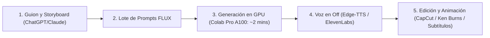

# Guía Maestra: Producción de Canales de YouTube Faceless con FLUX

Esta guía documenta la metodología técnica, los estilos visuales más rentables y el flujo de trabajo para crear canales de YouTube automatizados sin rostro (*Faceless YouTube Channels*) utilizando **FLUX** para la generación masiva de escenas ilustradas y caricaturas de alto impacto.

---

## 1. Por qué FLUX es el Rey de los Canales Faceless

En fotografía hiperrealista, un milímetro de curvatura extra en un dedo activa el **Valle Inquietante** (*Uncanny Valley*), haciendo que el espectador rechace la imagen.  
En cambio, en canales de YouTube de caricatura, animación o ilustración:

1. **Tolerancia Visual Absoluta:** Las manos estilizadas de 4 o 5 dedos, las caras exageradas y los trazos de cómic o 3D son interpretados por el cerebro como **estilo artístico**, no como error.
2. **Máxima Retención de Audiencia:** Los estilos ilustrados (Pixar 3D, Kurzgesagt 2D, Cómic Noir) retienen entre un **25% y 40% más de tiempo de visualización (*Watch Time*)** que las fotos genéricas de stock aburridas.
3. **Fidelidad Semántica Única de FLUX:** Gracias a su codificador de lenguaje T5, FLUX comprende instrucciones de estilo complejas sin mezclar estilos aleatorios.
4. **Capacidad de Escribir Texto Corto:** FLUX es capaz de pintar palabras cortas y legibles en carteles, letreros, camisetas y miniaturas (*thumbnails*), algo crucial para viñetas explicativas.
5. **Animación Limpia en Herramientas de Video:** Las caricaturas se animan de forma fluida y sin deformaciones en herramientas como Runway Gen-3, Kling, Pika o Luma Dream Machine.

---

## 2. Los 4 Estilos Visuales Más Rentables en YouTube Faceless

### Estilo A: 3D Pixar / Disney Animation
* **Nichos:** Crecimiento personal, psicología práctica, hábitos, finanzas personales, narración de historias de vida.
* **Fórmula de Prompt:**
  ```text
  3D animated stylized cartoon character, Pixar and Disney animation studio aesthetic, [DESCRIPCIÓN DEL PERSONAJE Y ACCIÓN], expressive emotional face, cinematic warm studio lighting, clean glossy textures, vibrant rich colors, octane render quality, 16:9 aspect ratio, no watermarks, no artist signature.
  ```
* **Ejemplo Práctico:**
  ```text
  3D animated stylized cartoon character, Pixar and Disney animation studio aesthetic, a curious young entrepreneur sitting at a modern wooden desk looking at a glowing golden piggy bank with coins floating, expressive hopeful smile, cinematic warm lighting, clean glossy textures, 16:9 aspect ratio, no watermarks.
  ```

---

### Estilo B: 2D Vector Flat (Estilo Kurzgesagt / Infographics)
* **Nichos:** Ciencia, geopolítica, economía, curiosidades del mundo, tecnología, resúmenes de historia.
* **Fórmula de Prompt:**
  ```text
  Modern 2D vector flat illustration in the distinctive style of Kurzgesagt and The Infographics Show, clean bold geometric shapes, flat vibrant color palette, [DESCRIPCIÓN DE LA ESCENA], high contrast, crisp lines, minimalist graphic background, editorial infographic aesthetic, 16:9 aspect ratio, no text artifacts.
  ```
* **Ejemplo Práctico:**
  ```text
  Modern 2D vector flat illustration in the distinctive style of Kurzgesagt, clean bold geometric shapes, vibrant color palette, an astronaut floating serenely beside a giant glowing atom core in deep cosmic space, high contrast, crisp lines, minimalist vector aesthetic, 16:9 aspect ratio.
  ```

---

### Estilo C: Novela Gráfica / Cómic Noir (Dark Graphic Novel)
* **Nichos:** Crímenes reales (*True Crime*), misterio, conspiraciones, historias de terror, casos sin resolver, historia oscura.
* **Fórmula de Prompt:**
  ```text
  Graphic novel comic book illustration, dark moody film noir aesthetic, dramatic ink cross-hatching, high contrast chiaroscuro shadows, [DESCRIPCIÓN DEL SUJETO O ESCENA], desaturated vintage colors with selective amber or red light, gritty cinematic mood, 16:9 aspect ratio, no text.
  ```
* **Ejemplo Práctico:**
  ```text
  Graphic novel comic book illustration, dark moody film noir aesthetic, dramatic ink cross-hatching, intense shadows, a determined detective in a trench coat standing under a flickering streetlamp in a rain-slicked dark alley, mysterious silhouette, gritty cinematic mood, 16:9 aspect ratio.
  ```

---

### Estilo D: Anime Suave / Studio Ghibli Watercolor
* **Nichos:** Filosofía (Estoicismo, Budismo), resúmenes de libros profundos, música lofi, reflexiones nocturnas.
* **Fórmula de Prompt:**
  ```text
  Studio Ghibli aesthetic, soft hand-painted watercolor anime background art, [DESCRIPCIÓN DEL PERSONAJE O PAISAJE], lush green nature, gentle fluffy clouds in sunny blue sky, warm nostalgic atmospheric lighting, peaceful and contemplative mood, 16:9 aspect ratio.
  ```
* **Ejemplo Práctico:**
  ```text
  Studio Ghibli aesthetic, soft hand-painted watercolor anime art, a solitary traveler with a backpack resting under a massive ancient oak tree looking out at rolling green hills and a quaint peaceful village at golden hour, gentle nostalgic lighting, 16:9 aspect ratio.
  ```

---

## 3. Flujo de Producción Rápido (De la Idea al Video Publicado)

Para producir un video de YouTube de **6 a 8 minutos**, se necesitan entre **35 y 50 imágenes**:



### Paso 1: Generar el Storyboard con LLM
Pídele a Claude o ChatGPT:
> *"Actúa como Director de Arte para un video de YouTube sobre [Tema]. Divide el guion en 35 escenas numeradas. Para cada escena, escribe la frase de la voz en off y un prompt en inglés usando la fórmula de [Estilo Elegido] de FLUX."*

### Paso 2: Generar las Imágenes con FLUX
* En una GPU A100 (Google Colab Pro), las **40 imágenes se generan en menos de 2 minutos**.
* Guarda todas en formato `.webp` o `.png` en resolución `1024x576` (16:9).

### Paso 3: Animación y Montaje
1. **El Efecto Ken Burns (Pan & Zoom Suave):** En CapCut o Premiere, no dejes las imágenes estáticas. Aplica un zoom lento hacia adelante (1.0x a 1.15x) o paneo lateral de 5 a 7 segundos.
2. **Escenas Clave con IA de Video (Opcional):** Si tienes 3 escenas cruciales en el video, pásalas por Kling AI o Runway Gen-3 para crear 5 segundos de animación 3D líquida.
3. **Subtítulos Dinámicos:** Genera subtítulos automáticos en CapCut con palabras destacadas en amarillo/verde para mantener el dinamismo.

---

## 4. Diseño de Miniaturas (*Thumbnails*) de Alto CTR con FLUX

Para la portada de YouTube, FLUX es una herramienta demoledora si aplicas estas 3 reglas:

1. **Un solo sujeto principal:** En plano medio o primer plano (*close-up*).
2. **Expresión facial exagerada:** `"Extreme shocked facial expression, wide eyes, open mouth"`.
3. **Fondo contrastante con iluminación de borde (*Rim Light*):** `"Bright contrasting rim light highlighting the character silhouette against a dark mysterious background"`.
4. **Palabra clave corta:** Puedes pedirle a FLUX que dibuje un cartel o título en la esquina: `"a glowing neon sign with the word 'WARNING'"`.

---

## 5. Resumen de Reglas de Oro

| Regla | Por qué es importante |
| :--- | :--- |
| **Mantener el prefijo de estilo idéntico** | Garantiza que las 40 imágenes del video parezcan dibujadas por el mismo ilustrador, dando una identidad visual consistente al canal. |
| **Evitar planos generales con multitudes diminutas** | Incluso en caricaturas, los rostros en primer y segundo plano lucen infinitamente más potentes que 20 figuras microscópicas. |
| **Generar directo en 16:9** | Evita tener que recortar o deformar imágenes en el editor de video. |
| **Usar FLUX.1-schnell (4 pasos)** | Para caricaturas, 4 pasos son más que suficientes; las texturas estilizadas quedan limpias y la velocidad es de 2 segundos por foto. |
