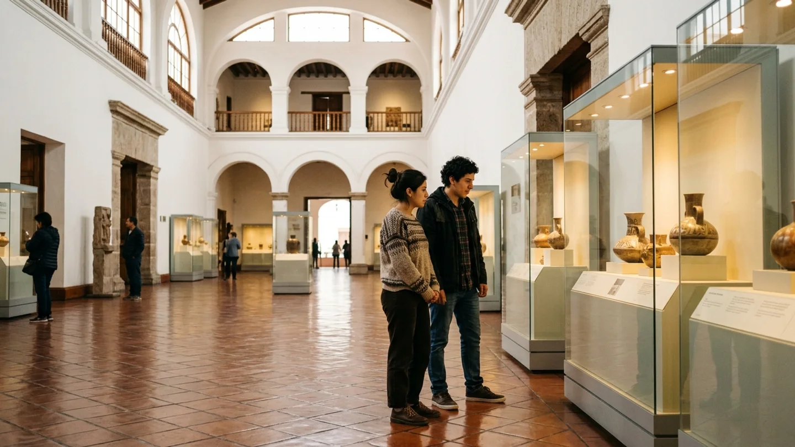
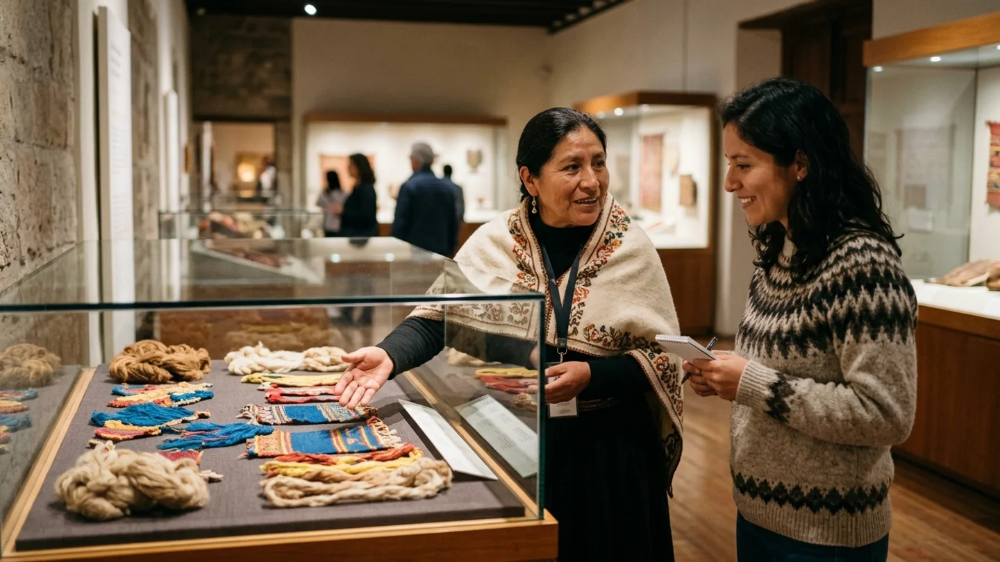
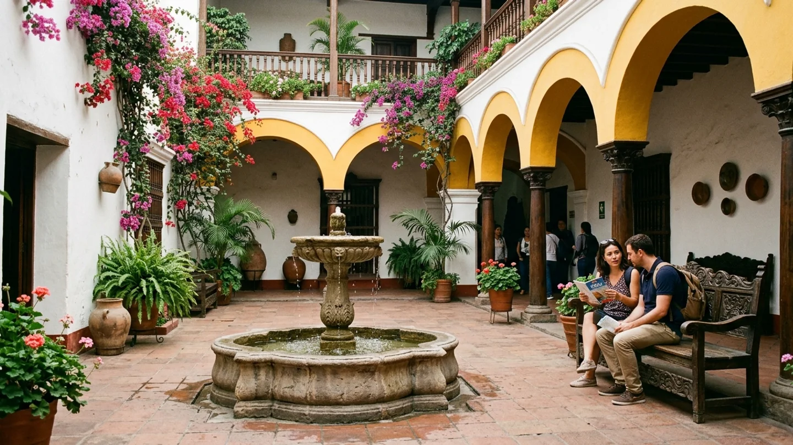

# Museos de Lima: cómo elegir una visita según tus intereses

> **ID de Propuesta:** TLB-001  
> **Categoría:** Lugares y patrimonio (`lugares-y-patrimonio`)  
> **Tiempo estimado de lectura:** 7 min  
> **Estado:** Borrador revisable en Staging  

---

  
*Ilustración editorial generada con IA; interpretación artística sobre la experiencia museística en Lima, no constituye fotografía documental de una colección registrada.*

---

Lima concentra una de las redes museísticas más ricas y variadas de Sudamérica, pero intentar abarcar varios recintos en una sola jornada sin un criterio claro suele resultar agotador. La clave para disfrutar de los museos de la capital radica en elegir según el periodo histórico que más te interese —arqueología prehispánica, arte virreinal, historia republicana o creación contemporánea— y agrupar la visita por cercanía geográfica.

Antes de planificar tu traslado, confirma siempre los horarios vigentes y el sistema de acceso: mientras algunas instituciones estatales ofrecen ingreso libre determinados días bajo normativas específicas, los museos privados de gestión autónoma requieren reserva anticipada en línea para garantizar el aforo.

---

## Primero, define qué periodo o expresión cultural deseas explorar

El patrimonio custodiado en Lima no responde a una sola narrativa homogénea. Cada museo ofrece una experiencia formativa distinta que conviene emparejar con el perfil del visitante:

| Periodo o Enfoque | Instituciones representativas | Distrito principal | Perfil sugerido |
| :--- | :--- | :--- | :--- |
| **Arqueología y Culturas Prehispánicas** | Museo Larco y MNAAHP | Pueblo Libre | Viajeros, estudiantes e interesados en civilizaciones andinas |
| **Arte Peruano Integral y Académico** | Museo de Arte de Lima (MALI) | Cercado de Lima | Público general, amantes de la pintura y arquitectura cívica |
| **Arte Virreinal y Platería** | Museo Pedro de Osma | Barranco | Aficionados a la imaginería colonial y casonas históricas |
| **Patrimonio Numismático y Cívico** | Museo Central (MUCEN) del BCRP | Cercado de Lima | Familias y recorridos a pie por el damero histórico |

---

## Grandes testimonios prehispánicos: del origen andino a los grandes señoríos

Si buscas comprender la profundidad temporal del territorio antes de la llegada de los españoles, el distrito de Pueblo Libre es el epicentro indiscutible. En este barrio tradicional conviven dos de los repositorios más importantes del continente.

El [portal oficial del Museo Larco](https://www.museolarco.org/) resguarda una célebre colección de más de 40.000 vasijas de cerámica, orfebrería y textiles de culturas del norte como Moche, Chimú, Cupisnique y Nasca. Destaca por su depósito abierto a los visitantes y sus jardines subtropicales. Por su parte, el [Museo Nacional de Arqueología, Antropología e Historia](https://mnaahp.cultura.pe/) (MNAAHP), fundado en 1822 como el primer museo de la república, custodia en la Plaza Bolívar piezas maestras de la civilización Chavín, mantos funerarios Paracas y el legado incaico.

Para complementar la mañana en Pueblo Libre, puedes consultar la oferta de [comercios y opciones en Pueblo Libre](/directorio?distrito=pueblo-libre) para almorzar o hacer una pausa en sus emblemáticas tabernas criollas.

---

  
*Ilustración editorial generada con IA; interpretación sobre la mediación cultural y educativa en salas de museo en Lima.*

---

## Arte virreinal, pintura académica y creaciones contemporáneas

Para los apasionados de las artes visuales, el [Museo de Arte de Lima (MALI)](https://mali.pe/), emplazado en el neorrenacentista Palacio de la Exposición, permite recorrer 3.000 años de historia artística mediante exposiciones que abarcan desde textiles prehispánicos hasta lienzos emblemáticos del siglo XIX y videoarte actual.

Hacia el sur, en el tradicional distrito de Barranco, el [Museo Pedro de Osma](https://www.museopedrodeosma.org/) ofrece un recorrido íntimo por una casona de verano de inicios del siglo XX con vitrales y jardines ornamentales. Su colección de pintura cuzqueña, esculturas en pasta y platería virreinal es una de las más destacadas de América del Sur. Al finalizar, el entorno bohemio conecta naturalmente con el [directorio de locales en Barranco](/directorio?distrito=barranco) con cafeterías de especialidad y librerías independientes.

> **Consejo editorial:** No intentes fotografiar cada sala ni apresurar el paso entre vitrinas. Dedicar quince minutos de observación detenida a una sola pieza maestra aporta mucho más que recorrer tres salas a paso acelerado.

---

## Colecciones de acceso libre y patrimonio cívico en el Centro

El Centro Histórico alberga opciones culturales de gran jerarquía que no requieren costo de admisión. El [Museo Central (MUCEN) del BCRP](https://www.bcrp.gob.pe/museocentral), situado en la intersección de los jirones Ucayali y Lampa, exhibe una notable pinacoteca republicana (con obras de Pancho Fierro, Merino y Sérvulo Gutiérrez), arqueología andina y salas de numismática que narran la evolución de la moneda nacional.

Esta visita se articula a la perfección con una [ruta a pie por el Centro Histórico de Lima](/blog/que-visitar-centro-historico-lima), permitiendo enlazar el museo con casonas, conventos e iglesias monumentales en un solo circuito peatonal.

---

## Logística práctica: compra anticipada y el programa Museos Abiertos

El acceso a los recintos gestionados por el Estado se rige por normativas claras. De acuerdo con el [Sistema Digital de Museos del Ministerio de Cultura](https://museos.cultura.pe/), la Ley N.º 30599 establece el ingreso gratuito para ciudadanos peruanos y residentes extranjeros el primer domingo de cada mes mediante el programa Museos Abiertos (MUA).

Para el resto del mes, ten en cuenta las siguientes pautas organizativas:

* **Días de apertura:** La mayoría de museos de Lima cierra los lunes por mantenimiento curatorial, abriendo de martes a domingo.
* **Venta anticipada:** En museos privados de alta demanda (como el Museo Larco), se aconseja adquirir los boletos previamente por internet para elegir turno y evitar colas en boletería.
* **Tarifas preferenciales:** Lleva siempre tu documento de identidad para acreditar tarifas reducidas para estudiantes, docentes o adultos mayores cuando apliquen.

---

  
*Ilustración editorial generada con IA; recreación visual de la arquitectura y patios de descanso de casonas y museos en Lima.*

---

## Cómo planificar un itinerario cultural realista de media jornada

Debido a las distancias interdistritales y la densidad del tráfico limeño, el error más común es intentar combinar museos lejanos entre sí en una misma mañana. Un itinerario eficiente debe respetar las siguientes etapas:

1. **Selecciona un solo clúster geográfico:** Elige Pueblo Libre (Larco + MNAAHP), el Cercado (MALI + MUCEN) o Barranco (Pedro de Osma + galerías locales).
2. **Calcula dos horas por recinto:** Ese tiempo permite apreciar la colección permanente, recorrer jardines o tiendas de publicaciones y descansar sin prisa.
3. **Reserva el almuerzo cerca del museo:** Los distritos culturales de Lima cuentan con sólida oferta gastronómica que enriquece la experiencia sin requerir traslados largos a mediodía.

La conservación del patrimonio material y su tránsito hacia formatos inmersivos abre debates sobre el futuro de las ciudades. Para quienes se interesan en cómo la tecnología transformará la preservación de la memoria histórica, invitamos a revisar los [ensayos sobre ciudades futuras y simulación tecnológica](https://mundossimulados.online/) como lectura complementaria.

---

### Fuentes y Referencias Consultadas
* [Sistema Digital de Museos del Ministerio de Cultura](https://museos.cultura.pe/) — Ley N.º 30599 y Programa Museos Abiertos.
* [Museo Larco](https://www.museolarco.org/) — Colección de arte precolombino e información general de visita.
* [Museo Nacional de Arqueología, Antropología e Historia del Perú (MNAAHP)](https://mnaahp.cultura.pe/) — Historia institucional y colecciones de Plaza Bolívar.
* [Museo de Arte de Lima (MALI)](https://mali.pe/) — Historia y acervo artístico del Palacio de la Exposición.
* [Museo Central (MUCEN) del BCRP](https://www.bcrp.gob.pe/museocentral) — Salas de arte, arqueología y numismática.
* [Museo Pedro de Osma](https://www.museopedrodeosma.org/) — Colección virreinal y sede histórica en Barranco.
